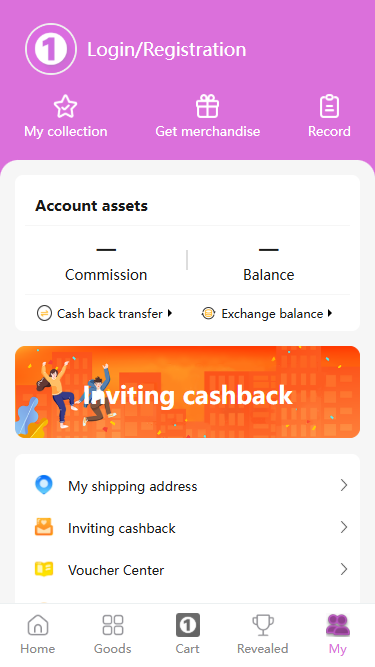
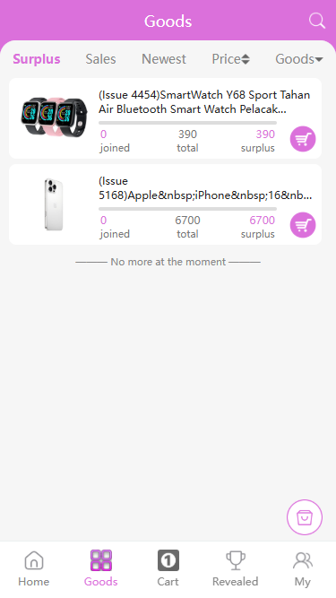
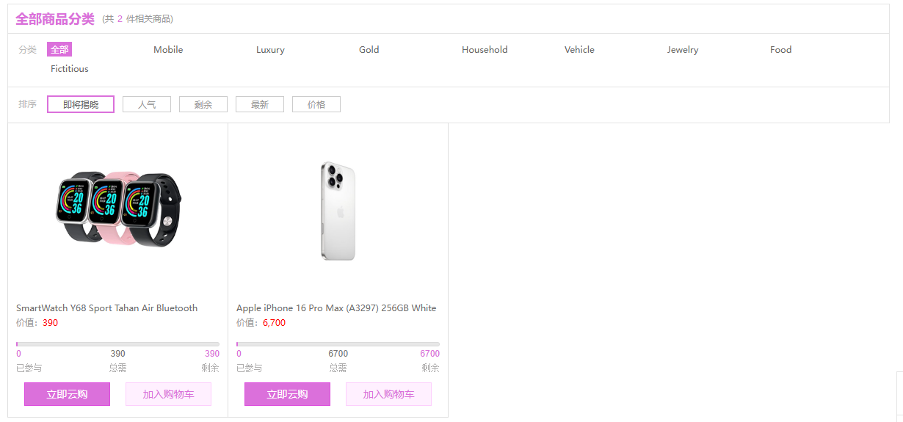
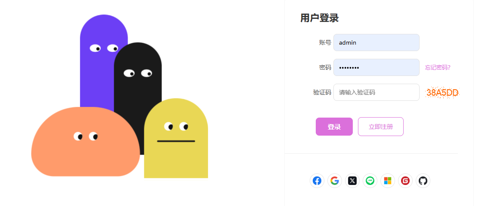

# YunGouCMS — Group-Buy / One-Yuan Shopping System

[简体中文](README.md) | **English**

[Official Website](https://www.yungoucms.com/) · [Live Demo](https://purple.yungoucms.com/) · [Free Official Authorization](https://copy.taolong.com/)

**Copyright © YunGouCMS**

YunGouCMS is a **PHP + MySQL** group-buy (云购夺宝 / 一元购) e‑commerce system. It uses a single-entry MVC structure and PATH_INFO–style URLs, and is easy to deploy on Nginx or Apache. It includes **multi-language** support and **data API collection** for multi-region operation and third-party data integration.

Free official authorization: https://copy.taolong.com/

Data API: https://api.taolong.com/blockchain

---

## Screenshots

### Desktop home


### Desktop product details


### Mobile

| Home | Product details | User center (signed out) |
|:---:|:---:|:---:|
|  |  |  |

<details>
<summary>More screenshots: product lists and desktop login</summary>

#### Mobile product list



#### Desktop product list



#### Desktop login



</details>

---

## Features

- **Group-buy / one-yuan shopping**: Full modules for staged group-buy products, orders, user shares, members, and cart
- **Multi-channel**: PC front (go), mobile (mobile), APP API (app), and admin backend (admin)
- **APIs & extensions**: Captcha, upload, payment, WeChat, and other API modules for integration and customization
- **Templates & assets**: Front-end templates and static files under `statics`, with support for multiple themes

### Multi-language

- **Multi-language** is configurable in the admin: products, articles, categories, etc. can be shown by language for multi-region or multi-locale sites
- The front-end can switch content and **multi-currency** by language (language and currency are linked) for a better international experience
- Language packs are separate from templates; adding a new language is straightforward (e.g. `system/funcs/languages/` and admin language management)

### Data API collection

- **Data API collection and integration**: Recommendation slots, market data, and similar content can be fetched or synced from external APIs (e.g. third-party data sources or crypto market feeds)
- Built-in HTTP request and data-push support: data can be pushed out or pulled in for aggregation and multi-site sync

---

## Requirements

| Item | Requirement |
|------|-------------|
| Web server | Nginx / Apache |
| PHP | ≥ 8.2 |
| MySQL | 8.0 |
| PHP extensions | pdo, pdo_mysql, json, mbstring, openssl, curl, gd, fileinfo, zip, etc. |
| Recommended | Redis, ionCube, fileinfo (e.g. via PHP extensions in Baota/Panel) |

---

## Directory structure (overview)

```
/
├── index.php              # Application entry
├── install.php            # Existing installer (not yet approved for public release)
├── system/                # Core and config
│   ├── config/            # Config files (e.g. database.inc.php)
│   ├── libs/              # Core classes (routing, template, etc.)
│   ├── modules/           # Modules (api, go, member, pay, mobile, etc.)
│   ├── funcs/             # Common functions and language packs
│   └── caches/            # Cache and logs (must be writable)
├── statics/               # Static assets and templates; uploads are runtime data
└── database/              # Working-tree SQL contains business data; not for direct publication
```

---

## Release status and deployment boundaries

**The current working tree is not a public, ready-to-install release.** Publication review is ongoing. Do not upload this directory, its existing Git history, production configuration, or the SQL files under `database/` as-is. The old history contains sensitive material; `.gitignore` does not remove it from past commits. A future release must use a separately reviewed snapshot with independent history, without replacing the existing `main` branch.

- The current admin route is `/admin`, served by `system/modules/admin/`. The old admin directory is retired and must not be recovered from old commits. Bot-member, fake-order and designated-winner features, as well as the admin login quick-access panel, have been removed and should not be restored from older instructions.
- The intended database release contains the schema for 111 tables and separately reviewed anonymized sample data only. The existing business SQL under `database/` is **not** release data. A `database/schema.sql` was generated in the isolated review directory but is not yet part of a release.
- Database/Redis example configuration and empty-credential WeChat Pay and QQ login configurations currently exist **only in the isolated review directory**, not in this production tree. Never publish production `system/config/database.inc.php`, payment keys, certificates, login identifiers, or JWT signing keys. Configure each integration privately before enabling it.
- The candidate inventory is for review, not an approved release manifest. Text matches and static media still require inspection; do not bundle the uploads directory wholesale. Production credentials and historically exposed secrets must be reviewed and rotated by the responsible operator.

---

## Deployment notes (after release review)

1. Deploy an **approved release package** to the site root; verify that it contains `index.php`, `system/modules/admin/`, and the required static assets. Do not restore admin code from the old Git history.
2. Configure database, Redis, payment, and third-party login credentials privately. Copy the future release's database example into a local configuration file; do not commit actual credentials.
3. Set up PATH_INFO URL rewriting. Nginx example:

   ```nginx
   location / {
       if (!-e $request_filename) {
           rewrite ^/(.*)$ /index.php/$1 last;
       }
   }
   ```

   For Apache, consult the root `.htaccess`. The front-end is at `/`; the current admin route is `/admin/index`.
4. `install.php` has not passed release review: **do not describe it as a ready-to-run public installer**. Database initialization must use the reviewed schema and installation procedure. After installation, remove or restrict the installer and grant only the necessary runtime write permissions to cache and upload paths; avoid keeping the configuration directory broadly writable.

---

## Notes

- The entry point is the root `index.php`. URLs use PATH_INFO (for example `/api/checkcode/image/80_27/` or `/go/index/init`), not `/?/`.
- This repository contains a sanitized source snapshot. Runtime configuration, database files, and user uploads are excluded; it is not a complete, ready-to-deploy distribution.

---

**Copyright © YunGouCMS**
